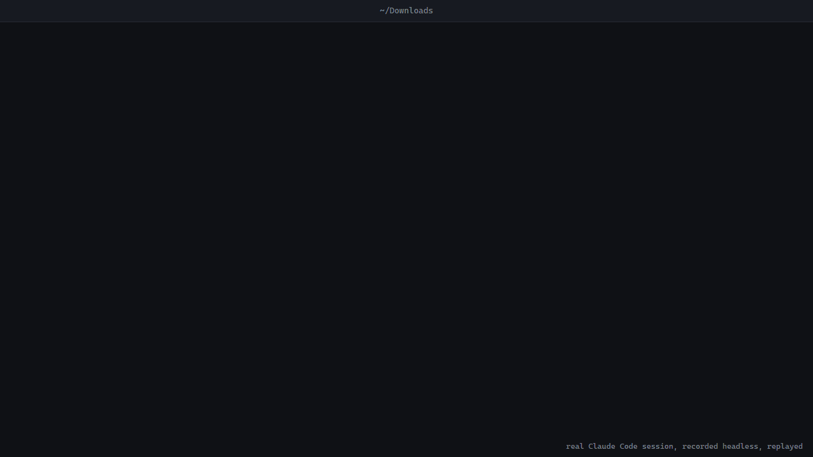

<p align="center"></p>

# wasnew

wasnew 는 AI 에이전트의 파일 조작을 되돌리는 계층이다. 에이전트가 아무 폴더에서 한 이동, 이름 바꾸기, 삭제를 모두 저널에 남기고, 작업 단위로 되돌린다. git 이 있든 없든.



실제 Claude Code 세션을 헤드리스로 돌리고 그 로그를 재생한 화면이다 ([scripts/demo](scripts/demo/)). [MP4](assets/demo.mp4) 로도 볼 수 있다.

[English](README.md) | [한국어](README.ko.md)


에이전트는 다운로드 폴더를 정리하고, 사진 이름을 바꾸고, 프로젝트를 치운다. Claude Code 문서는 "Checkpointing does not track files modified by Bash commands" 라고 적고 그 예로 `rm`, `mv`, `cp` 를 든다([출처](https://code.claude.com/docs/en/checkpointing)). git 은 저장소 안의 커밋한 파일만 되돌린다.

wasnew 는 에이전트에게 옮기기와 휴지통 MCP 도구를 준다. 조작마다 누가 왜 했는지 폴더 안 저널에 남고, 지우기는 휴지통으로 가고, 명령 하나로 작업 전체를 되돌린다.

> 아이콘은 삭(新月), 달이 새것(new)이었던(was) 순간입니다. 아래 머리카락만 한 빛이 곧 [willnew](https://github.com/Haejyn/willnew) 의 초승달이 됩니다.

## 시작하기

아직 npm 에 올리지 않았다. 소스에서 설치한다 (Node 20 이상, pnpm):

```bash
git clone https://github.com/Haejyn/wasnew && cd wasnew
pnpm install && pnpm build
claude mcp add --transport stdio wasnew -- node "$PWD/bin/wasnew.js" mcp --root ~/Downloads
```

Claude Desktop 은 `claude_desktop_config.json` 에:

```json
{ "mcpServers": { "wasnew": { "command": "node", "args": ["/path/to/wasnew/bin/wasnew.js", "mcp", "--root", "C:/Users/me/Downloads"] } } }
```

## 에이전트 세션 예

```text
user   다운로드 폴더별로 정리하고 쓰레기는 치워 줘
agent  wasnew_snapshot  "before sorting"              → 201 files
agent  wasnew_plan      199 operations                → 0 issues, no approval needed
agent  wasnew_apply     plan f51626427972437c         → 177 moved into 12 folders, 22 trashed
user   wasnew undo --batch plan-f51626427972437c      → undone 199
```

## MCP 도구

| 도구 | 하는 일 |
|---|---|
| `wasnew_snapshot` | 지금 내용을 저장. 여러 파일을 바꾸기 전에 |
| `wasnew_move` | 이동, 이름 바꾸기. 목적지가 있으면 `DEST_EXISTS` 로 거부. 작업마다 batch 하나, `reason` 으로 사유 |
| `wasnew_trash` | 지우기 대신 휴지통으로. `wasnew_undo` 로 되돌림 |
| `wasnew_plan` | 이동과 휴지통 목록을 아무것도 건드리지 않고 검사. 조작마다 문제와 승인 필요 여부를 알려 줌 |
| `wasnew_apply` | 계획을 정확히 그대로, 한 번만, 한 batch 로. 승인 전이면 `NEEDS_APPROVAL`, 그 사이 폴더가 바뀌었으면 `PLAN_INVALID` |
| `wasnew_undo` | 묶음 전체, 묶음의 마지막 N개, 또는 마지막 N개를 되돌림. 못 되돌린 것은 이유와 함께 |
| `wasnew_restore` | 스냅샷 내용으로 복원. 덮어쓸 파일은 먼저 `guard` 스냅샷으로 저장 |
| `wasnew_diff` | 추가, 변경, 사라짐, 이동(내용 해시로 감지). 사용자에게 한 일을 설명할 때 |
| `wasnew_history` | 한 파일의 이동, 휴지통, 되돌림, 복원을 언제, 누가, 왜 했는지 |
| `wasnew_where` | 옛 경로의 파일이 지금 어디 있는지. 폴더째 옮긴 것, 휴지통, 되돌림까지 따라감. 없는 경로로 실패한 호출에도 `movedTo` 로 붙음 |
| `wasnew_read` | 파일을 그 시점의 내용으로 읽기 |
| `wasnew_log` | 스냅샷 목록 |
| `wasnew_pending` | 아직 되돌릴 수 있는 이동 |
| `wasnew_redo` | 되돌린 것을 다시 하기. 묶음 전체나 마지막 N개. 새 조작으로 기록되어 `wasnew_undo` 로 다시 되돌릴 수 있음 |
| `wasnew_lessons` | 이 폴더에서 사용자가 되돌린(avoid) 조작 종류와 여러 번 그대로 둔(ok) 종류 |
| `wasnew_agents` | 이 폴더에서 에이전트마다 조작 수, 되돌린 수, 되돌림 비율 |

- 접속한 클라이언트 이름(`clientInfo`)이 에이전트로 기록되고, 모델은 `model` 과 `reason` 을 덧붙인다
- 승인 도구는 MCP 에 없다. 에이전트는 스스로 승인할 수 없다
- 기본은 `--root` 안의 파일만 옮긴다. 밖에서 가져오는 일은 `--allow-outside-sources` 로 켠다
- 도구 실패는 프로토콜 에러가 아니라 `isError` 결과로 돌아온다. 에이전트가 코드를 읽고 고쳐서 다시 시도한다
- 큰 결과는 `summary` 몇 줄(`751 × *.jpg  Downloads/ → sorted/jpg/`)과 앞 20개만 `truncated: true` 와 함께 돌려준다. 50개를 넘는 목록은 `full: true` 일 때만 전부 ([토큰 비용](#토큰-비용))
- 셸의 `rm`, `mv` 까지 막으려면 [Claude Code 훅 예제](examples/claude-code/)

## 정책 (`.wasnew/policy.json`)

```json
{ "protect": ["Taxes/", "*.key"], "requireApprovalOver": 20, "maxOpsPerBatch": 1000, "allowTrash": true }
```

| 키 | 뜻 |
|---|---|
| `protect` | gitignore 문법. 옮기기, 휴지통, 그 자리로 옮겨 오기 모두 거부. 보호된 파일을 품은 폴더도 |
| `requireApprovalOver` | 이보다 많은 조작은 계획 → 사람의 `approve` → 적용으로만 |
| `maxOpsPerBatch` | 한 batch 의 최대 조작 수 (폭발 반경) |
| `allowTrash` | `false` 면 휴지통도 끔 |
| `trust` | `{ "minOps": 50, "maxUndoRate": 0.05, "approvalOver": 200 }`. 조작이 `minOps` 이상이고 되돌림 비율이 `maxUndoRate` 이하인 에이전트는 `requireApprovalOver` 대신 `approvalOver` 를 씀. 기본값보다 낮아지지 않고, 이름 없이(unknown) 기록된 에이전트에는 적용 안 됨 |

정책 파일이 잘못되면 고칠 때까지 모든 조작이 `POLICY_INVALID`로 막힌다.

## 계획 → 승인 → 적용

```text
agent  wasnew_plan   → plan baebff75: 3 operations, 0 issues, needs the user's approval (wasnew approve baebff75)
person wasnew show baebff75
person wasnew approve baebff75
agent  wasnew_apply  → done 3, batch plan-baebff75
person wasnew history "copy of notes.md"
       trash  copy of notes.md -> trash/…  by claude-code 2.1.0 (sort Downloads)
person wasnew undo --batch plan-baebff75
```

계획은 앞선 조작의 결과를 따라가며 검사한다. 이미 옮겨진 원본, 계획 안에서 겹치는 목적지, 보호 경로, 한도를 조작 번호와 함께 알려 준다.

## 되돌림에서 배우기와 신뢰

wasnew 는 저널의 이동과 휴지통을 종류별로(조작, 확장자나 폴더, 원래 폴더, 옮긴 폴더) 묶고 그중 몇 개가 되돌려졌는지 센다. 두 번 이상, 절반 이상 되돌려진 종류는 avoid 교훈이 된다. 에이전트가 접속하면 그중 5개까지 MCP instructions 에 붙고, `wasnew_plan` 은 계획 안의 조작과 맞는 교훈을 `lessons` 로 돌려준다:

```text
Past undos in this folder:
- avoid: moving *.hwp from ./ to Docs/ was undone 3 of 3 times (claude-code)
- avoid: trashing folders in ./ was undone 2 of 2 times (claude-code)
```

같은 숫자로 에이전트마다 되돌림 비율이 나오고(`wasnew agents`), `trust` 정책 키는 이 비율로 승인 기준을 올린다. 에이전트 이름은 MCP 클라이언트의 `clientInfo` 로, 모델이 아니라 클라이언트 프로그램이 정한다. 기록은 버전을 뗀 클라이언트 이름으로 모아서, 클라이언트를 업데이트해도 이어진다. 예전 에이전트가 쓴 `reason` 은 `wasnew_lessons` 결과에만 남고 다른 에이전트의 instructions 에는 들어가지 않는다. 신뢰는 승인 요청을 줄이는 편의 기능이고 보안 경계가 아니다. 접속하는 프로그램은 어떤 이름이든 보낼 수 있다.

## 실측

같은 일을 wasnew 와 git 으로 해 본 결과(`scripts/bench-git.mjs`). 세 번 잰 중앙값, 단위는 따로 적지 않으면 ms. Windows 11 NTFS, Intel i5-12400F (12 스레드), Node 24.14, git 2.53.0.windows.2, 2026-10-17. 재는 동안 다른 프로세스가 CPU 를 30% 쯤 쓰고 있어서 절대 시간은 흔들린다. 같은 줄 안에서 비교해 주세요.

git 쪽에서 정리는 `fs.rename` 뒤 `git add -A && git commit`, 되돌리기는 `git reset --hard HEAD~1`, 휴지통은 `git rm` 뒤 `git reset --hard`. 세 번째 열은 압축을 끈 git 으로, 압축이 안 되는 데이터에 더 공정하다.

미디어: 8개 × 256 MB 무작위(압축 안 되는) 데이터

| 단계 | wasnew | git | git (압축 끔) |
|---|---:|---:|---:|
| 첫 스냅샷 | 4,348 | 71,588 | 23,543 |
| 다시 스냅샷, 바뀐 것 없음 | 2 | 44 | 43 |
| 정리 (모든 파일을 하위 폴더로) | 11 | 11,458 | 11,732 |
| 정리 되돌리기 | 12 | 8,667 | 8,714 |
| 10% 휴지통 + 되돌리기 | 9 | 2,328 | 2,351 |
| 저장소 크기 | 2,048.0 MB | 2,048.7 MB | 2,048.3 MB |

작은 파일: 5,000개 × 4 KB

| 단계 | wasnew | git | git (압축 끔) |
|---|---:|---:|---:|
| 첫 스냅샷 | 2,336 | 7,034 | 7,880 |
| 다시 스냅샷, 바뀐 것 없음 | 151 | 57 | 53 |
| 정리 | 2,646 | 3,699 | 3,797 |
| 정리 되돌리기 | 2,572 | 2,566 | 2,647 |
| 10% 휴지통 + 되돌리기 | 555 | 659 | 630 |
| 저장소 크기 | 21.9 MB | 20.3 MB | 20.5 MB |

큰 파일에서 wasnew 가 빠른 건 이동과 되돌리기가 이름 바꾸기라서다. git 은 작업 트리를 다시 쓰고 내용을 다시 해시한다. 작은 파일의 다시 스냅샷에서 지는 건 wasnew 가 Node 에서 파일마다 stat 을 하고, git 은 Windows 에서 캐시한 디렉터리 스캔을 쓰기 때문이다. 작은 파일 되돌리기는 거의 같다 (2,572 대 2,566 ms).

```bash
pnpm build && pnpm bench:git
```

`pnpm bench` 는 wasnew 만 더 큰 폴더에서 잰다. 마지막 기록(Linux, Intel Xeon 2.1 GHz 4코어, Node 22.22, 2026-10-02): 1 GiB 하나를 포함한 파일 2,626개 스냅샷 5.4 s, 최대 RSS 162 MB. 같은 폴더 다시 스냅샷 0.24 s, 이동 2,625건 2.9 s, 그 묶음 되돌리기 2.9 s.

## 토큰 비용

큰 작업 뒤에 에이전트가 읽는 양(`pnpm bench:tokens`, 조작 5,300건: 이동 5,000 · 휴지통 300). 토큰은 글자 수 / 4 로 어림했다.

| 결과 | 글자 | ~토큰 |
|---|---:|---:|
| `wasnew_undo`, 모든 항목 (요약 전) | 1,578,276 | 394,569 |
| `wasnew_undo`, 요약 + 앞 20개 (지금) | 6,746 | 1,687 |
| `wasnew_move`, 이동 5,000건 (전) | 71 | 18 |
| `wasnew_move`, 이동 5,000건 (지금, 요약 포함) | 249 | 62 |
| `git status --porcelain`, 같은 변경 | 343,351 | 85,838 |

그 되돌리기 뒤에 에이전트가 읽는 요약:

```text
1,988 × *  sorted/2026/*/ → inbox/ (undone)
1,049 × *.png  sorted/png/ → inbox/ (undone)
1,004 × *.txt  sorted/txt/ → inbox/ (undone)
959 × *.pdf  sorted/pdf/ → inbox/ (undone)
300 × *.tmp  trash → inbox/ (undone)
```

## 비교

| | wasnew | git | Claude Code 체크포인트 | Cline 체크포인트 | Gemini CLI 체크포인트 | AgentFS |
|---|---|---|---|---|---|---|
| 기록 대상 | 도구로 한 이동, 이름 바꾸기, 휴지통과 파일 내용 스냅샷 | 커밋한 내용 | Claude 의 파일 편집 도구로 한 편집 | 도구를 쓸 때마다 작업 공간 상태를 그림자 git 에 커밋 | 파일을 바꾸는 도구를 승인하기 전 프로젝트 상태 | 모든 파일 조작, 도구 호출, 상태 변화 |
| 셸 `rm` / `mv` | 직접 실행하면 기록 안 됨. 예제 훅이 막고 도구를 쓰라고 알려 줌 | 커밋한 파일만 되돌림 | 추적 안 함 | 다음 그림자 커밋에 담김 | 문서에 언급 없음 | AgentFS 안에서 하면 기록 |
| 작업 위치 | 이미 있는 아무 폴더 | git 저장소 | 세션의 프로젝트 | 작업 공간 | 프로젝트 | AgentFS 파일시스템 안 (SDK, FUSE 또는 NFS 마운트) |
| 저장 | 폴더 안 `.wasnew/` | `.git/` | 세션 스냅샷, 기본 약 30일 뒤 삭제 | 프로젝트 git 과 따로 둔 그림자 git | `~/.gemini/history/` 아래 그림자 git | SQLite 파일 하나 |

각 문서에 적힌 것: Claude Code 는 바깥에서 바꾼 파일과 동시에 돌던 다른 세션의 편집을 잡지 않는다. Cline 은 아주 큰 저장소에서 체크포인트가 저장 공간을 많이 쓰고 느려질 수 있다고 적는다. Gemini CLI 체크포인트는 기본으로 꺼져 있다. wasnew 는 조작마다 에이전트, 모델, 사유를 남긴다. git 은 이름 바꾸기를 유사도로 추정하고, 커밋 안 한 변경을 에이전트별로 나누지 않는다.

출처: [Claude Code checkpointing](https://code.claude.com/docs/en/checkpointing) · [Cline checkpoints](https://docs.cline.bot/features/checkpoints) · [Gemini CLI checkpointing](https://geminicli.com/docs/cli/checkpointing/) · [AgentFS](https://github.com/tursodatabase/agentfs)

## CLI

```bash
wasnew snapshot -m "정리 전"  # --if-changed 면 같은 상태는 다시 안 남김
wasnew watch                  # 폴더가 바뀔 때마다 스냅샷 (wasnew 를 안 쓰는 프로그램용 안전망)
wasnew log
wasnew diff <id>              # 지금과 비교, 두 번째 id 를 주면 스냅샷끼리
wasnew pending --batch agent-1
wasnew undo --batch agent-1   # -n 3 이면 마지막 3개만
wasnew redo --batch agent-1   # 되돌린 것을 다시, -n 3 이면 마지막으로 되돌린 3개만
wasnew restore <id> docs/a.md
wasnew plans                  # show <id>, approve <id>, apply <id> 도
wasnew history <path>
wasnew where <path>           # 옛 경로의 파일이 지금 어디 있는지
wasnew lessons                # 사람들이 되돌리거나 그대로 둔 조작 종류
wasnew agents                 # 에이전트마다 조작 수와 되돌림 비율
wasnew recover                # 죽은 프로세스가 남긴 반쯤 기록된 조작 정리
wasnew policy
wasnew gc --keep-last 20      # 저장소 정리, 기본은 미리보기, --apply 로 실행
wasnew empty-trash --older-than-days 30   # 진짜 삭제, 기본은 미리보기, --apply 로 실행
```

모든 명령에 `--root <폴더>`(기본 현재 폴더)와 `--json`.

## 라이브러리

```ts
import { openVault, isWasnewError } from "wasnew";

const vault = await openVault("C:/Users/me/Downloads");
const by = { agent: "my-agent", reason: "정리" };
const before = await vault.snapshot({ label: "정리 전" });
await vault.move("스크린샷 (3).png", "Pictures/2026/스크린샷 (3).png", "run-42", by);
await vault.trash("임시.tmp", "run-42", by);
const { undone, skipped } = await vault.undo({ batch: "run-42" });
await vault.redo({ batch: "run-42" });           // 마음이 바뀌면 다시, undo 로 또 되돌릴 수 있다
const { avoid } = await vault.lessons();          // 이 폴더에서 사람들이 되돌린 것
const { guard } = await vault.restore(before.id);   // guard 로 복원도 되돌린다

const plan = await vault.plan([{ op: "move", from: "a.pdf", to: "Docs/a.pdf" }], { by });
if (!plan.issues.length) await vault.apply(plan.id);
await vault.history("Docs/a.pdf");
```

## 원칙

- 사용자 파일을 지우지 않는다. 지우기는 휴지통으로 옮기기이고, 복원은 덮어쓸 내용을 먼저 저장한다. 진짜 삭제는 사람이 부르는 `emptyTrash` 하나뿐이고 MCP 에는 없다
- 이동은 저널로. 볼륨을 넘은 이동도 복사 → 대조 → 원본 삭제로 하고 되돌린다
- 기록 전에 죽어도 잃지 않는다. 조작마다 `inflight` 표식을 먼저 쓰고, 저널에 쓴 뒤 지운다. `recover` 가 남은 표식을 디스크 상태로 판정해 저널에 올린다
- 같은 내용은 한 번만 저장 (sha256 내용주소). 큰 파일은 흘려 보내며 해시한다
- 안 바뀐 파일은 다시 읽지 않는다. 크기와 수정 시각이 지난 스냅샷과 같으면 그 해시를 쓴다. 스냅샷 직전 2초 안에 수정된 파일은 믿지 않고 다음에 다시 읽는다 (git 의 racy 규칙)
- 저널은 한 번에 한 작성자. 잠금 파일로 여러 프로세스가 같은 번호를 내지 않게 한다
- 저장소 정리는 명시적으로만. `gc` 는 기준이 있어야 돌고, 기본이 미리보기이며, 가장 최근 스냅샷은 늘 남긴다

## 저장 구조

```
<root>/.wasnew/
  objects/<aa>/<나머지 62자>   내용주소 blob
  snapshots/<id>.json         스냅샷 manifest (partial: 복원 전 guard 처럼 일부만 담은 것)
  journal.jsonl               이동, 휴지통, 되돌림, 복원, 계획, 승인, 앱 이벤트 (append-only)
  trash/<id>/<path>           휴지통
  plans/<id>.json             계획
  inflight/<id>.json          진행 중인 조작 (정상이면 비어 있다)
  policy.json                 정책
  statcache.json              크기와 수정 시각 → 해시 캐시
<root>/.wasnewignore          gitignore 문법, 스냅샷에서 뺄 것
```

에러 코드: `DEST_EXISTS`, `OUTSIDE_ROOT`, `IN_STORE`, `NOT_FOUND`, `CROSS_DEVICE_DIR`, `COPY_MISMATCH`, `SNAPSHOT_NOT_FOUND`, `NOT_IN_SNAPSHOT`, `BAD_SNAPSHOT_ID`, `POLICY_INVALID`, `POLICY_PROTECTED`, `POLICY_LIMIT`, `POLICY_DENIED`, `NEEDS_APPROVAL`, `PLAN_NOT_FOUND`, `PLAN_INVALID`, `PLAN_APPLIED`, `RESERVED_OP`, `LOCKED`, `GC_NEEDS_POLICY`.

## 개발

```bash
pnpm test        # 130개: 스냅샷, stat 캐시, watch, 복원 guard, 볼륨 간 이동, 잠금, 휴지통, 출처, 정책, 계획/승인, 복구, MCP 왕복, 훅, 요약, 교훈, 신뢰, 다시 하기
pnpm typecheck
pnpm build       # dist/ 에 CLI 와 MCP 서버
pnpm bench       # bench:git, bench:tokens 도
```

wasnew 는 ISNEW 앱의 파일 정리 엔진이 쓰는 되돌리기 계층으로 처음 만들어졌습니다.

## 제한

- MCP 는 실제 stdio 왕복과 테스트로 검증했습니다. Claude Desktop, Claude Code 클라이언트에 붙여서는 아직 돌려 보지 않았습니다
- 테스트는 CI 에서 ubuntu, windows, macOS 와 Node 20, 22 로 돕니다. 실측 숫자는 표마다 적은 한 대에서만 쟀습니다
- 정책 파일은 wasnew 도구로는 못 고치지만, 에이전트가 다른 편집 도구로 고치는 것까지 막지는 않습니다
- `maxOpsPerBatch` 는 batch 를 단 조작만 셉니다
- 볼륨을 넘어 폴더를 통째로 옮기지 못합니다(`CROSS_DEVICE_DIR`). 파일 단위로 옮겨 주세요
- 지금과 비교하는 `diff` 는 모든 파일을 해시합니다
- 내용을 바꾸면서 크기와 수정 시각까지 되돌려 놓는 프로그램은 캐시를 속일 수 있습니다. 그럴 땐 `snapshot --rehash`를 쓰세요
- `watch` 는 Node 의 재귀 감시(`fs.watch`)를 씁니다. 네트워크 드라이브에서는 변경 알림이 오지 않을 수 있습니다

## FAQ

### Claude Code 가 rm, mv 를 되돌릴 수 있나요?

체크포인트로는 안 됩니다. 문서에 `rm`, `mv`, `cp` 같은 Bash 명령으로 바뀐 파일은 추적하지 않는다고 적혀 있습니다. wasnew 를 붙이면 에이전트가 `wasnew_trash`, `wasnew_move` 를 쓰고, [훅 예제](examples/claude-code/)가 셸 명령을 막습니다.

### AI 에이전트가 지운 파일은 어떻게 되살리나요?

`wasnew_trash` 로 지웠다면 `wasnew undo --batch <batch>` 를 실행하거나 에이전트에게 `wasnew_undo` 를 부르게 합니다. wasnew 밖에서 지워졌어도 스냅샷이 있으면 `wasnew restore <스냅샷>` 으로 내용을 되살립니다. [CLI](#cli) 참고.

### git 이 필요한가요?

아니요. 아무 폴더에서 돌고, 데이터는 그 폴더의 `.wasnew/` 에 둡니다. git 저장소 안에서도 git 과 같이 씁니다.

### Claude Code 체크포인트와 무엇이 다른가요?

체크포인트는 한 세션 안에서 Claude 의 파일 편집 도구로 한 편집을 다룹니다. wasnew 는 아무 폴더의 이동, 이름 바꾸기, 삭제를 다루고, 어떤 에이전트가 왜 했는지 남기며, 저널이 폴더에 있어 세션이 바뀌어도 남습니다. [비교](#비교) 참고.

### 에이전트가 rm -rf 를 못 하게 하려면?

Claude Code 라면 [examples/claude-code](examples/claude-code/) 의 `PreToolUse` 훅을 붙입니다. `rm`, `mv`, `del`, `Remove-Item`, `git clean`, `git reset --hard`, `find -delete` 를 막고 wasnew 도구를 쓰라고 알려 줍니다. 명령 문자열을 보기 때문에 스크립트 안에서 지우는 것은 못 막습니다. 스냅샷 훅이나 `wasnew watch` 를 같이 두세요.

### 에이전트가 자기 계획을 스스로 승인할 수 있나요?

아니요. 승인 도구는 MCP 에 없습니다. 사람이 터미널에서 `wasnew approve <id>` 를 실행하기 전까지 `wasnew_apply` 는 `NEEDS_APPROVAL` 로 거부합니다. [계획 → 승인 → 적용](#계획--승인--적용) 참고.

### Codex, Gemini CLI, Cursor 에서도 되나요?

MCP 클라이언트라면 16개 도구를 모두 씁니다. 그 클라이언트의 MCP 설정에 `wasnew mcp --root <폴더>` 를 stdio 서버로 넣으세요. 셸을 막는 훅과 옮겨진 파일 훅은 Claude Code 의 훅 형식으로 만들었습니다.

### 디스크를 얼마나 쓰나요?

첫 스냅샷은 모든 파일 내용을 한 벌 저장해서 폴더 크기만큼 씁니다 ([실측](#실측)에서 미디어 2 GB 에 2,048 MB). 다음 스냅샷은 새 내용만 더하고, 이동과 휴지통은 이름 바꾸기라 늘지 않습니다. `wasnew gc`, `wasnew empty-trash` 로 비웁니다.

### 옮기는 도중에 프로세스가 죽으면?

조작마다 파일을 건드리기 전에 `inflight` 표식을 쓰고 저널에 쓴 뒤 지웁니다. `wasnew recover` 가 남은 표식을 디스크와 대조해 실제로 일어난 일을 저널에 올리므로 그 이동도 되돌릴 수 있습니다.

### 옮겨진 파일은 에이전트가 어떻게 찾나요?

`wasnew_where` 가 저널을 따라가 지금 경로를 알려 주고, 없는 경로로 실패한 호출에도 `movedTo` 가 붙습니다. Claude Code 에서는 옮겨진 파일 훅이 사라진 경로의 `Read`, `Edit` 를 막고 새 경로를 알려 줍니다.

## 라이선스

코드는 MIT. 이름과 로고는 라이선스에 포함되지 않아요([NOTICE](NOTICE)).
